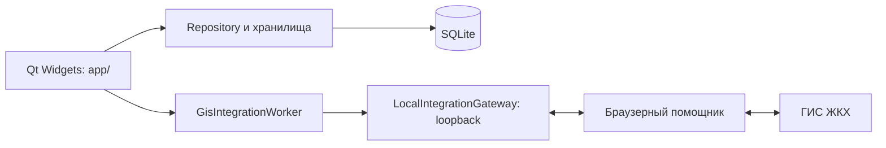

# Архитектура и разработка

## Компоненты

Приложение состоит из настольного клиента на Python/PySide6, локальной SQLite и браузерного помощника. Интерфейс и обработка ответов работают в клиенте. Помощник выполняет запросы к ГИС ЖКХ в авторизованной вкладке браузера; логин и пароль в клиент не передаются.



Пути Python-модулей указаны относительно `src/gis_jkh_assistant/`; каталог `browser-extension/` находится в корне репозитория.

| Компонент | Реализация и ответственность |
| --- | --- |
| Запуск и координация интерфейса | `__main__.py`, `app/main_window.py`: создание страниц, рабочий контекст, тема, завершение фоновых операций |
| Страницы и общие элементы | `app/*_page.py`, `app/page_layouts.py`, `app/workflow_widgets.py`, `app/sidebar_navigation.py`: формы, таблицы, команды и боковая навигация |
| УО, дома и тарифы | `database/models.py`, `database/repository.py`, `database/house_fee_tariffs.py`: организации, дома, параметры управления, локальные точки изменения и отдельные точные периоды платы из ГИС |
| Перечни, планирование и фиксация | `work_lists/`, `work_planning.py`, `work_fixation.py`, методы `Repository`: сопоставление работ, годовые и месячные показатели, внеплановые работы и фотографии |
| Оценка качества и акты | `quality_assessment.py`, `quality_automation.py`, `database/quality_assessment_store.py`, `database/act_requisites_store.py`, `acceptance_act_details.py`, `acceptance_act_pdf.py`: оценка, связи документов с работами, реквизиты и PDF |
| Информация о размере платы | `management_fees.py`, `fee_bulk.py`, `app/management_fees_page.py`: локальные проекты, снимки сведений по договорам, подготовка периодов по тарифам и проверка массовых операций; история тарифов хранится отдельно |
| Транзакции | `database/transactions.py`: `AtomicConnection.atomic()` объединяет вызовы хранилищ в одну операцию с откатом при ошибке |
| Обмен с ГИС | `app/gis_integration_worker.py`, `gis_integration/local_gateway.py`, `gis_integration/organization_context.py`, `browser-extension/background.js`: выполнение команд, маршрутизация по УО и доставка результатов |
| Файлы и установка помощника | `gis_files/`: импорт и экспорт Excel; `browser/helper_installation.py` и `app/helper_setup_dialog.py`: подготовка расширения и мастер подключения |
| Оформление и ресурсы | `app/styles.py`, `app/icons.py`, `app/assets/`: QSS, темы, SVG-иконки и логотипы |

## Интерфейс и рабочий контекст

`MainWindow` содержит страницы в `QStackedWidget`; `SidebarNavigation` управляет выбором раздела. Порядок: УО, дома, перечни, планирование, фиксация, оценка качества, информация о размере платы, настройки. Переходы рабочего процесса разрешаются через ссылки на страницы, чтобы перестановка бокового меню не меняла назначение команд.

УО выбирается в `OrganizationsPage` и действует во всём приложении. `MainWindow` хранит общий контекст и передаёт организацию страницам. Скрытые селекторы УО служат адаптерами существующих контроллеров. До смены УО сохраняются правки всех затронутых страниц; при ошибке сохранения или активной операции переключение блокируется.

В общем режиме дом, перечень и год переносятся между разделами. В независимом режиме страницы сохраняют собственный выбор внутри общей УО. Месячные страницы отдельно хранят открытый месяц и диапазон массовой операции. Настройки и сохранённый общий контекст находятся в SQLite; выбор года и месяца для каждого перечня хранится в памяти страницы через `app/selection_memory.py`.

## Хранение и связи данных

`Repository` открывает SQLite и содержит методы работы с УО, домами, перечнями, планами и фиксацией. Хранилища оценки и реквизитов актов, а также `ManagementFeeStore` используют ту же базу. `AtomicConnection` поддерживает транзакции операций, затрагивающих несколько методов хранилищ.

УО объединяет дома и историю подписантов организации. Дом содержит параметры управления, помещения, площади, тарифы и представителей собственников. К дому относятся перечни; к перечню относятся годовые планы, месячная фиксация и оценка качества. Фотографии связаны с фактическими и внеплановыми работами, акты могут быть связаны с несколькими оцениваемыми работами. Документ сохраняет снимок реквизитов на дату подготовки.

История `house_tariffs` содержит локальные точки изменения. Массовая загрузка размещённой платы сохраняет отдельный снимок точных периодов в `house_fee_tariff_snapshots` с привязкой к УО и ФИАС. `list_effective_house_tariffs` объединяет источники для интерфейса и расчётов: локальные интервалы имеют приоритет, противоречивые суммы ГИС на одном участке исключаются. Физические локальные записи не меняются; Excel продолжает работать с их прежним форматом. Снимки документов, основания и локальные проекты хранятся отдельно в `management_fee_records` и `management_fee_context`. Снимок тарифов и сведения одной загрузки применяются атомарно.

Идентификаторы разных систем сохраняют собственное назначение: ОГРН и идентификаторы организации, GUID дома в ГИС и ФИАС, корни документов и их версии. Их нельзя подменять друг другом. При импорте УО используется сокращённое наименование, с полным в качестве резервного.

Чтение платы допускает размещённые периоды вне границ договора и хранит их исходные даты. Такие записи помечаются в снимке тарифов и исключаются из `list_effective_house_tariffs`. При частичном ответе по договорам снимок дополняется подтверждёнными записями, сохраняя непрочитанные. `FeeAmendment` в `fee_bulk.py` связывает одну существующую запись с одним локальным тарифом; перед транзакцией перепроверяются тарифы, область дома и снимок записи. Применение меняет локальный документ и признак правок, сохраняя удалённый GUID и `lastUpdate`. Интерфейс генерации и очереди ограничивает выбор одним открытым домом.

В Windows профиль расположен в `%LOCALAPPDATA%\GIS JKH Assistant\`, на Linux используется `XDG_DATA_HOME` или `~/.local/share/`. База `data.db`, настройки и локальные файлы отделены от EXE. Выбор пути и перенос старого имени каталога реализованы в `database/paths.py`.

## Обмен и завершение операций

Страница запускает `GisIntegrationWorker`, который обращается к `LocalIntegrationGateway`. Gateway слушает только loopback и передаёт команды браузерному помощнику. Перед запросами проверяется организация. Ответ возвращается обработчику страницы; локальное применение и сохранение результата составляют отдельный этап. Наличие подключения к gateway не подтверждает успех операции в ГИС или сохранение ответа в SQLite.

`connect_result` учитывает выполняющиеся обработчики, в том числе при открытом модальном диалоге. `MainWindow` отслеживает фоновые задачи и блокирует закрытие базы до их завершения. Контроллеры очередей (`app/portfolio_import.py`, `app/fee_bulk_queue.py`) хранят область действия и результат каждого шага; после запроса закрытия следующий шаг не запускается. `FeeJob` фиксирует дом, УО и проверенный снимок проекта. Запись в ГИС предваряется сохранением `pending` в существующей таблице сведений; неопределённый ответ не повторяется автоматически, сверка выполняется чтением через `ManagementFeeStore.import_remote`. Формирование локальных проектов повторно проверяет предпросмотр и сохраняет набор одной транзакцией.

Сохранение проекта в ГИС и его размещение могут быть последовательными серверными операциями. Ошибка размещения не откатывает уже сохранённый проект. Для изменяемых сведений о плате проверяется версия документа (`lastUpdate`); неопределённый ответ требует чтения состояния перед повторной записью.

## Инварианты сохранности

- Ошибка автосохранения оставляет ввод в редакторе. Переход и закрытие не должны терять несохранённые значения.
- Импорт плана охватывает строки и метаданные одной транзакцией. Некорректный ответ не заменяет прежний план.
- Синхронизация сохраняет пользовательские акты, локальные файлы фотографий, связи, внеплановые и исторические строки. Отсутствие объекта в неполном ответе не подтверждает удаление.
- Импорт Excel сначала проверяет весь набор и показывает изменения. Пустая ячейка сохраняет прежнее значение, явно введённый ноль остаётся значением. Сопоставление не зависит от порядка строк.
- Импорт файлов ГИС проверяет структуру и обязательные поля; неизвестный номер версии сам по себе не служит причиной отказа.
- Планирование и месячные операции требуют размещённого перечня. Проект оценки можно сохранить без актов; размещение проверяет документы включённых работ.
- Месячная операция и диапазон массовой обработки имеют разную область действия. Массовая отправка ограничивается годом и периодом перечня; прежние записи за его пределами сохраняются.
- PDF создаётся до замены автоакта. Документ, связи и снимок реквизитов сохраняются вместе. Изменение карточек не переписывает сохранённые документы.
- Подписанты выбираются по дате акта; неоднозначный выбор требует решения пользователя. Частичные сведения заказчика и печатные подстановки не подтверждают полномочия или подписание.
- Аннулированные сведения о плате доступны для просмотра. Если аннулирование загружено при наличии локальных правок, они сохраняются отдельным локальным проектом.

## Разработка и проверки

В PR с пользовательскими изменениями обновляйте README и CHANGELOG. Исправления тестов записывайте в CHANGELOG. Архитектурный документ обновляйте при изменении компонентов, связей данных или обработки операций.

Разработка и Windows-сборка используют Python 3.12. Установка зависимостей:

```powershell
py -3.12 -m venv .venv
.\.venv\Scripts\python.exe -m pip install -e ".[dev]"
```

Обычный запуск обращается к пользовательскому профилю. Для экспериментов создавайте отдельную `Repository` и подменяйте gateway, как в `tests/test_ui_workflow.py`. Для проверки EXE задавайте отдельный `LOCALAPPDATA` дочернего процесса. Рабочие базы, HAR с сессиями, выгрузки и персональные документы в Git не добавляются.

```powershell
.\.venv\Scripts\python.exe -m gis_jkh_assistant
```

Проверки:

```powershell
$env:QT_QPA_PLATFORM = "offscreen"
.\.venv\Scripts\python.exe -m pytest -q
.\.venv\Scripts\python.exe -m ruff check .
node --test
.\.venv\Scripts\python.exe -B tools/package_browser_helper.py --check
```

Qt-тесты используют временные базы и имитации ответов. Полный набор запускается в Windows и Linux; авторизация и записывающие операции в реальной ГИС требуют отдельной проверки. Сравнения текста PDF учитывают переносы строк, зависящие от шрифта. Проверки компоновки требуют доступности элементов после прокрутки и места для рабочих строк таблицы. История исправлений хранится в [CHANGELOG](../CHANGELOG.md). Для исследования нативных падений сохранены workflow `diagnose-linux-qt.yml` и тестовый plugin `tools/qt_diagnostic_plugin.py`; приложение этот plugin не загружает.

Размер интерфейса в настройках зафиксирован на 100%. Нативный DPI обрабатывает Qt; существующие регрессии масштабирования не отключаются.

## Сборка Windows

Программа собирается в один EXE. Файлы помощника включены в ресурс `browser/assets/browser-helper.zip`; мастер также использует подготовленную папку рядом с EXE. После изменения расширения обновляйте ресурс:

```powershell
.\.venv\Scripts\python.exe -B tools/package_browser_helper.py
```

Команды сборки и упаковки из корня репозитория:

```powershell
$buildPython = (Resolve-Path ".\.venv\Scripts\python.exe").Path
$savedBuildPath = $env:PATH
try {
    $pythonDirectory = Split-Path -Parent $buildPython
    $env:PATH = "$pythonDirectory;$env:SystemRoot\System32;$env:SystemRoot;$env:SystemRoot\System32\Wbem"
    & $buildPython -m PyInstaller --clean --noconfirm --onefile --windowed --paths src --collect-data gis_jkh_assistant.browser --collect-data gis_jkh_assistant.app --icon src/gis_jkh_assistant/app/assets/branding/app.ico --name "GIS JKH Assistant" src/gis_jkh_assistant/__main__.py
    if ($LASTEXITCODE -ne 0) { throw "Ошибка сборки EXE" }
} finally {
    $env:PATH = $savedBuildPath
}
& $buildPython -B tools/package_windows.py
```

SVG-иконки находятся в `app/assets/icons/light` и `dark`; логотипы тем и значок EXE находятся в `app/assets/branding`. Ресурсы включаются в EXE через `--collect-data gis_jkh_assistant.app`, светлый ICO передаётся в `--icon`. Контрольные суммы SVG-иконок проверяются тестом. При чтении нормализуется только регистр тега `lineargradient`, необходимый Qt для отображения градиентов тёмного набора; исходные файлы и цвета сохраняются.

Собирайте в отдельном Python-окружении. Каталоги сторонних инструментов в `PATH` могут подменить Qt/ICU DLL при упаковке. Команда сборки временно оставляет в `PATH` каталог Python и системные каталоги Windows.

`tools/package_windows.py` формирует ZIP по явному списку: `GIS JKH Assistant.exe`, `browser-extension/manifest.json`, `browser-extension/background.js`, `README.md`. Флаг `--no-readme` исключает инструкцию; `--exe` и `--output` задают другие пути. Остатки прежней сборки и дополнительные файлы каталогов в архив не попадают. Папка помощника соответствует проверяемому встроенному ресурсу. Ошибка упаковки не заменяет предыдущий архив.

Версия приложения задана в `VERSION` и `__init__.py`; версия помощника находится в манифесте и встроенном ресурсе. Их согласованность проверяется тестами. Эти значения входят в EXE и помощник; отдельные VERSION.txt и BUILD_INFO.json для работы не нужны. Описание GitHub-релиза содержит только версии программы и помощника. Коммит и SHA256 EXE записываются в итог шага GitHub Actions.

Workflow `build-windows.yml` проверяет проект, собирает EXE и вызывает тот же упаковщик. При успешной сборке `main` обновляется существующий `dev-latest`; PR создаёт только проверочную сборку. Техническая история выпусков хранится в [CHANGELOG](../CHANGELOG.md).
